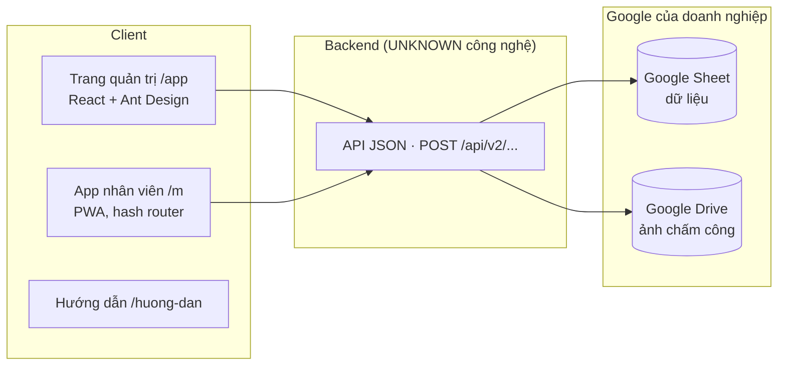

# 01. Tổng quan sản phẩm — E-HRM Pro (WORKSHEET)

> Website tham khảo: `https://chamcong.worksheet.vn/app/`
> Phạm vi phân tích: dữ liệu mẫu ngành **Nhà hàng / quán cà phê** (công ty mẫu "Cà phê Phố Nhỏ"), khảo sát ngày 31/10/2026.
> Quy ước kiểm chứng dùng trong toàn bộ bộ tài liệu:
> - **CONFIRMED** — đã trực tiếp quan sát trên giao diện hoặc trong response API mà chính giao diện tải về.
> - **INFERRED** — suy luận từ hành vi giao diện, tên file, cấu trúc dữ liệu hoặc từ trang hướng dẫn chính thức (`/huong-dan/`) nhưng chưa tự thao tác kiểm chứng.
> - **UNKNOWN** — không xác định được (thiếu quyền, thao tác bị chặn, hoặc không có dữ liệu).

## 1. Website là gì?

**E-HRM Pro** (thương hiệu **WORKSHEET** – worksheet.vn) là một Web App quản lý nhân sự ca kíp cho doanh nghiệp nhỏ tại Việt Nam, gồm 3 nghiệp vụ lõi: **chấm công – xếp ca – tính lương**. (CONFIRMED)

Thông điệp chính trên màn đăng nhập: *"Chấm công, xếp ca, tính lương — mỗi sáng chỉ cần xử lý vài việc. Hệ thống tự ghép giờ vào ra đúng ca, kể cả ca đêm. OT, chấm sai ca, ngoài vùng được gom vào một chỗ để bạn duyệt nhanh."* (CONFIRMED)

Sản phẩm gồm **2 ứng dụng web** dùng chung một backend:

| Ứng dụng | URL | Người dùng | Trạng thái |
|---|---|---|---|
| Trang quản trị (Admin) | `/app/` | Chủ / quản lý / nhân sự | CONFIRMED |
| App nhân viên (PWA) | `/m/` | Nhân viên chấm công | CONFIRMED |
| Hướng dẫn quản trị | `/huong-dan/` | Quản trị | CONFIRMED |
| Hướng dẫn nhân viên | `/huong-dan/nhan-vien` | Nhân viên | CONFIRMED |
| Giao diện cũ | `/cu/admin` | Quản trị | UNKNOWN (chỉ được nhắc trong hướng dẫn, chưa truy cập) |

## 2. Mục đích sử dụng

- Nhân viên dùng điện thoại chấm công vào/ra ca, có kiểm tra **vị trí GPS (geofence)** và tuỳ chọn **chụp ảnh khuôn mặt**. (CONFIRMED UI; chụp ảnh INFERRED vì demo tắt camera)
- Hệ thống **tự ghép lần chấm vào ca**, tự phát hiện bất thường: đi muộn, về sớm, thiếu giờ vào/ra, vắng, chấm ngoài vùng, chấm sai ca, ở lại sau ca (OT đề xuất). (CONFIRMED)
- Quản lý **duyệt các bất thường** ở một hộp việc duy nhất ("Hộp việc") theo đề xuất của hệ thống. (CONFIRMED)
- Quản lý **xếp ca** theo tuần cho nhân viên ca linh hoạt (part-time), nhận **đăng ký ca** do nhân viên gửi từ app. (CONFIRMED)
- Hệ thống **tính lương tự động** từ công đã duyệt + cấu hình lương theo vị trí + OT đã duyệt + thưởng/phạt; quản lý **công bố phiếu lương** cho nhân viên xem trong app. (CONFIRMED)
- Dữ liệu nằm trên **Google Sheet của chính doanh nghiệp**; ảnh chấm công lưu ở **Google Drive** của doanh nghiệp. (CONFIRMED — ghi rõ trong modal mua gói và trang Cài đặt)

## 3. Đối tượng người dùng

| Vai trò | Quyền (theo giao diện Nhân sự) | Kiểm chứng |
|---|---|---|
| **Quản trị viên** | Toàn quyền, kể cả Cài đặt công ty | CONFIRMED (mô tả quyền) |
| **Nhân sự** | Quản lý nhân sự, ca, lương, duyệt. Không sửa được Quản trị viên | CONFIRMED (mô tả quyền) |
| **Quản lý nhóm** | Vào trang quản trị, xem và duyệt công cho người mình quản lý; không thấy mức lương (theo hướng dẫn) | CONFIRMED (mô tả) / INFERRED (giới hạn hiển thị) |
| **Chỉ dùng app** (nhân viên) | Chấm công, gửi đơn, xem lương của mình | CONFIRMED |

Phân khúc mục tiêu: doanh nghiệp nhỏ theo 7 ngành mẫu — Văn phòng/dịch vụ, Cửa hàng/bán lẻ, **Nhà hàng/quán cà phê**, Kho/xưởng, Trung tâm giáo dục, Spa/salon/phòng khám, Nhiều loại hình. Quy mô gói: dưới 20, 20–60, 60–120 nhân sự. (CONFIRMED)

## 4. Giá trị cốt lõi

1. **"Duyệt theo đề xuất"** — mỗi bất thường có lý do ("Vì sao hệ thống đề xuất") và một đề xuất xử lý; quản lý chỉ cần bấm 1 nút hoặc phím `A`. (CONFIRMED)
2. **Cấu hình theo Vị trí** — ca, ngày làm, địa điểm, lương, phụ cấp, phạt, BHXH, hệ số OT cấu hình một lần cho cả nhóm; nhân viên chỉ ghi đè phần khác biệt. (CONFIRMED)
3. **Lương minh bạch** — mỗi dòng phiếu lương có công thức ("10.000.000 ÷ 26 công chuẩn × 26 công"). (CONFIRMED)
4. **Dữ liệu thuộc về doanh nghiệp** — lưu trên Google Sheet riêng. (CONFIRMED — tuyên bố của sản phẩm)
5. **Không cần cài app từ store** — app nhân viên là web/PWA, cài lên màn hình chính. (CONFIRMED)
6. **Giá rẻ, trả 1 lần/năm hoặc vĩnh viễn** — từ 249.000đ/năm. (CONFIRMED)

## 5. Các nhóm chức năng chính

| Nhóm | Màn hình | Mô tả ngắn |
|---|---|---|
| A. Xác thực & dùng thử | Đăng nhập, Chọn ngành mẫu | Đăng nhập Mã công ty + Email + PIN; demo theo ngành |
| B. Hộp việc | `/app/` | KPI hôm nay + danh sách việc cần duyệt + chi tiết + duyệt |
| C. Điều phối (real-time) | `/app/dieu-phoi` | Ai đang làm/chưa tới, bản đồ, dòng thời gian ca, nhật ký 24h |
| D. Bảng công | `/app/bang-cong` | Lưới công cả kỳ / theo tuần, duyệt loạt, Excel, bảng công từng người |
| E. Xếp ca | `/app/xep-ca` | Xếp theo người/ngày, rải lịch, chép tuần, mẫu tuần, nhận đăng ký ca |
| F. Lương | `/app/luong` | Quỹ lương, sao kê từng người, thưởng/phạt, công bố phiếu, in, Excel |
| G. Nhân sự | `/app/nhan-su` | CRUD nhân viên, phân quyền, thêm hàng loạt, gửi link cài app, mở khoá máy |
| H. Vị trí & ca | `/app/vi-tri` | Vị trí (mẫu lương/ca), thư viện ca, ngày lễ |
| I. Địa điểm | `/app/dia-diem` | Vùng chấm công (geofence), gợi ý từ lần chấm thật |
| J. Cài đặt | `/app/cai-dat` | Thông tin công ty, Google Sheet/Drive, màu thương hiệu, quy tắc chấm công, nhập file, kiểm tra dữ liệu |
| K. Tiện ích chung | toàn app | Tìm nhanh Ctrl+K, tour hướng dẫn, thiết lập nhanh 4 bước, mua gói |
| L. App nhân viên | `/m/` | Chấm công, Lịch & công, Tạo đơn, Lương, Tôi |

## 6. Cấu trúc sản phẩm

- Quan hệ API → Google Sheet: CONFIRMED về mặt tuyên bố sản phẩm và trường `row` (số dòng) trong response; cơ chế cụ thể UNKNOWN.

## 7. Đặc điểm nổi bật (từ góc nhìn sản phẩm)

- Một màn **Hộp việc** gom mọi loại việc (OT, thiếu giờ, vắng, ngoài vùng, sai ca, đơn nghỉ, đăng ký ca…) với bộ lọc chip có đếm số. (CONFIRMED)
- **Thanh thời gian (timeline bar)** so sánh khung ca (sọc) với giờ có mặt (màu) xuất hiện nhất quán ở Hộp việc, Điều phối, Bảng công, app nhân viên. (CONFIRMED)
- **Phím tắt**: `J/K` chuyển việc, `A` duyệt theo đề xuất, `E` mở bảng công ngày, `Ctrl/⌘+K` tìm nhanh. (CONFIRMED hiển thị; Ctrl+K CONFIRMED hiển thị nhãn)
- **Deep link** qua query string: `/app/bang-cong?ngay=2026-10-31&nv=<email>`, `/app/luong?nv=<email>`, `/app/vi-tri?tab=ca`. (CONFIRMED)
- **Coach-mark tour** theo từng trang thiết lập, nhớ đã xem bằng localStorage. (CONFIRMED)
- **Màu thương hiệu tuỳ biến** đổi toàn hệ thống (admin + app nhân viên), mỗi công ty một màu (demo nhà hàng: nâu `#7B5236`). (CONFIRMED)
- **Gắn thiết bị** (mỗi tài khoản một điện thoại) chống chấm hộ; quản lý "Mở khoá máy". (CONFIRMED UI + hướng dẫn)
- **Công bố & đóng băng phiếu lương**; sửa sau đó phải "Công bố lại". (CONFIRMED)
- **Demo theo ngành**: mỗi lần mở demo tạo một công ty mẫu riêng (`DEMO-FNB-XXXXXX`), dữ liệu 45 ngày, tự làm mới sau 6 giờ. (CONFIRMED)

## 8. Giới hạn phân tích

| Khu vực | Lý do | Trạng thái |
|---|---|---|
| Bước thanh toán (quét QR, kích hoạt) | Thao tác bị chặn bởi kiểm tra an toàn; không nhập thông tin cá nhân | UNKNOWN |
| "Thử công ty mới" (trial trắng) | Chưa mở để tránh tạo dữ liệu | UNKNOWN |
| Chấm công thật (VÀO CA/RA CA) | Trình duyệt chặn quyền vị trí; không bấm | UI CONFIRMED, xử lý INFERRED |
| Chụp ảnh khi chấm | Demo tắt camera | INFERRED (theo hướng dẫn) |
| Xuất Excel / In phiếu | Không tải file | INFERRED |
| Kiểm tra dữ liệu Google Sheet, Nhập file Excel/JSON | Demo không dùng Sheet thật | INFERRED |
| Giao diện cũ `/cu/admin` | Không truy cập | UNKNOWN |
| Backend, cơ sở dữ liệu thực | Chỉ quan sát được response API | UNKNOWN |

## 9. Nhật ký khảo sát & đối chiếu (Bước 6 — Cross-check)

**Nguồn đã dùng:** giao diện admin ở 5 độ rộng (375, ~800, 900, 992, 1024, 1440px), app nhân viên đăng nhập tài khoản demo "Lê Ngọc Ánh · phục vụ part-time" (người dùng tự bấm đăng nhập), response API do giao diện tải, trang hướng dẫn quản trị & nhân viên.

**Thao tác ghi đã thực hiện trên dữ liệu demo** (demo cho phép bấm thử, tự làm mới sau 6 giờ): duyệt 1 OT (Trần Đức Minh 24/10), từ chối 1 đơn nghỉ (Vũ Khánh Linh 04/11). Các thao tác khác (chép tuần, đổi màu, sửa form) đều đã **huỷ/không lưu**.

**Bổ sung sau đối chiếu:**
- Phát hiện bảng "Số người mỗi ca" và nút ✓/✕ từng ô đăng ký **chỉ có ở desktop** → đã thêm SCH-16, cập nhật SCH-12, 04, 06, 08.
- Xác nhận "Thu gọn menu" (205px → 65px) → cập nhật GEN-05, 05.

**Mâu thuẫn / bất thường còn tồn tại (ghi nhận, không suy diễn nguyên nhân):**
1. OT 24/10 đã duyệt ở Hộp việc nhưng sao kê Lương vẫn hiện "96p chờ".
2. Lưới Xếp ca compact không hiển thị ô đăng ký ca dù banner mô tả có.
3. Thanh lưu Cài đặt chồng bottom nav ở ~800px (bấm "Huỷ" kích hoạt "Bảng công").
4. Rời trang Cài đặt / huỷ drawer Vị trí khi có thay đổi: không cảnh báo, mất thay đổi.
5. Drawer xếp ca ghi "Xong bấm Lưu ở cuối trang" nhưng nút là "Xong".
6. Từ chối đơn không yêu cầu lý do.
7. Esc không đóng drawer chi tiết Hộp việc (đóng được modal tìm kiếm).
8. Demo: mỗi tab mở demo tạo một công ty mẫu mới (mã khác nhau), dữ liệu giữa 2 tab độc lập.
