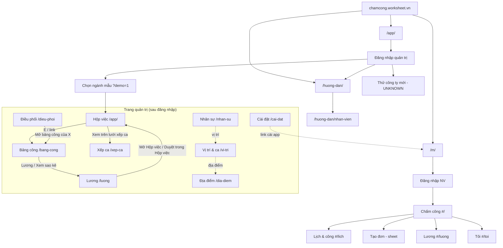
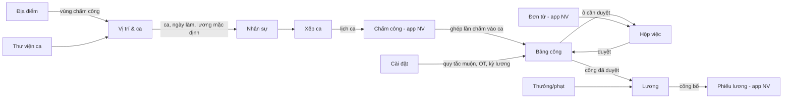

# 02. Sơ đồ website (Sitemap)

## 1. Danh sách trang & URL

### 1.1. Trang quản trị `/app/` (router dạng path — History API)

| # | Trang | URL | Truy cập từ | Kiểm chứng |
|---|---|---|---|---|
| A1 | Đăng nhập quản trị | `/app/` (khi chưa có phiên) | Trực tiếp | CONFIRMED |
| A2 | Chọn ngành dữ liệu mẫu | `/app/?demo=1` | Nút "Xem dữ liệu mẫu"; link "Xem mẫu ngành khác" | CONFIRMED |
| A3 | Thử công ty mới | (UNKNOWN — mở từ nút "Thử công ty mới") | Màn đăng nhập | UNKNOWN |
| B | Hộp việc (trang chủ) | `/app/` | Menu "Hộp việc" | CONFIRMED |
| C | Điều phối | `/app/dieu-phoi` | Menu | CONFIRMED |
| D | Bảng công | `/app/bang-cong` · `?ngay=YYYY-MM-DD&nv=<email>` mở drawer ngày | Menu, tìm nhanh, link "Mở bảng công của …" | CONFIRMED |
| E | Xếp ca | `/app/xep-ca` | Menu | CONFIRMED |
| F | Lương | `/app/luong` · `?nv=<email>` | Menu, link "Lương" trong bảng công người | CONFIRMED |
| G | Nhân sự | `/app/nhan-su` | Menu Thiết lập | CONFIRMED |
| H | Vị trí & ca | `/app/vi-tri` · tab Ca: `?tab=ca` | Menu Thiết lập | CONFIRMED |
| I | Địa điểm | `/app/dia-diem` | Menu Thiết lập | CONFIRMED |
| J | Cài đặt | `/app/cai-dat` | Menu Thiết lập | CONFIRMED |
| — | Hướng dẫn quản trị | `/huong-dan/` (tab mới) | Menu "Hướng dẫn sử dụng" | CONFIRMED |
| — | Hướng dẫn nhân viên | `/huong-dan/nhan-vien` | Trang hướng dẫn | CONFIRMED |
| — | App nhân viên (demo) | `/m/?demo=<mã công ty>` (tab mới) | "Mở app nhân viên" | CONFIRMED |
| — | Báo lỗi & góp ý | Google Form bên ngoài (`docs.google.com/forms/...`, tab mới) | Menu | CONFIRMED |
| — | Giao diện cũ | `/cu/admin` | Chỉ nhắc trong hướng dẫn | UNKNOWN |

### 1.2. App nhân viên `/m/` (router dạng hash)

| # | Trang | URL | Kiểm chứng |
|---|---|---|---|
| M1 | Đăng nhập | `/m/` · `?ma=<mã công ty>` (link mời) · `?demo=<mã>` (demo) | CONFIRMED |
| M2 | Chấm công (trang chủ) | `/m/#/` | CONFIRMED |
| M3 | Lịch & công (tab Bảng công / Lịch ca) | `/m/#/lich` | CONFIRMED |
| M4 | Tạo đơn (bottom sheet, 6 loại) | mở từ nút "+" giữa thanh dưới | CONFIRMED |
| M5 | Lương (danh sách phiếu) + Phiếu lương (sheet) | `/m/#/luong` | CONFIRMED |
| M6 | Tôi | `/m/#/toi` | CONFIRMED |

### 1.3. Overlay toàn cục (không có URL riêng)

| Overlay | Kiểu | Mở từ | Kiểm chứng |
|---|---|---|---|
| Tìm nhanh | Modal command palette | Icon kính lúp / Ctrl+K | CONFIRMED |
| Menu tài khoản | Dropdown | Avatar | CONFIRMED |
| Menu "Thêm" (mobile) | Drawer trái | Tab "Thêm" của thanh dưới | CONFIRMED |
| Thiết lập nhanh | Modal 4 bước | Menu "Thiết lập nhanh" | CONFIRMED |
| Upsell "Thấy hợp với công ty bạn?" | Bottom sheet | Tự hiện sau một thời gian dùng demo | CONFIRMED (điều kiện kích hoạt INFERRED) |
| Chọn gói & thanh toán | Modal | "Chọn gói", "Dùng cho công ty bạn" | CONFIRMED (bước QR UNKNOWN) |
| Tour hướng dẫn (coach mark) | Popover có bước | Lần đầu vào trang Nhân sự/Vị trí/Địa điểm/Cài đặt; nút "?" | CONFIRMED |

## 2. Cấu trúc menu

### Desktop (≥ ~992px) — Sidebar trái 205px
```
[Logo công ty] Cà phê Phố Nhỏ / Dữ liệu dùng thử
  Hộp việc (badge số việc)
  Điều phối
  Bảng công
  Xếp ca
  Lương
THIẾT LẬP
  Nhân sự
  Vị trí & ca
  Địa điểm
  Cài đặt
───────────── (đáy)
  Thiết lập nhanh
  Hướng dẫn sử dụng ↗
  Báo lỗi & góp ý ↗
  [Thẻ dùng thử: Dùng cho công ty bạn · Mở app nhân viên ↗ · Xem mẫu ngành khác]
  Thu gọn menu
```
### Mobile/tablet (< ~992px) — Thanh dưới 5 mục
`Hộp việc (badge) · Điều phối · Bảng công · Xếp ca · Thêm` → "Thêm" mở drawer trái chứa toàn bộ menu desktop.

### App nhân viên — Thanh dưới 5 mục
`Chấm công · Lịch & công · (+) Tạo đơn · Lương · Tôi (chấm đỏ khi có thông báo)`

## 3. Sơ đồ sitemap (Mermaid)



## 4. Quan hệ dữ liệu giữa các trang


(Quan hệ CONFIRMED qua giao diện và hướng dẫn; cơ chế backend INFERRED.)
