# 06. Luồng người dùng (User Flows)

Ký hiệu: nhánh ✅ thành công · ❌ thất bại · ⚠️ ngoại lệ. Bước có [I] là suy luận (hướng dẫn chính thức / dữ liệu), còn lại CONFIRMED.

## UF-01 · Quản trị đăng nhập & vào demo

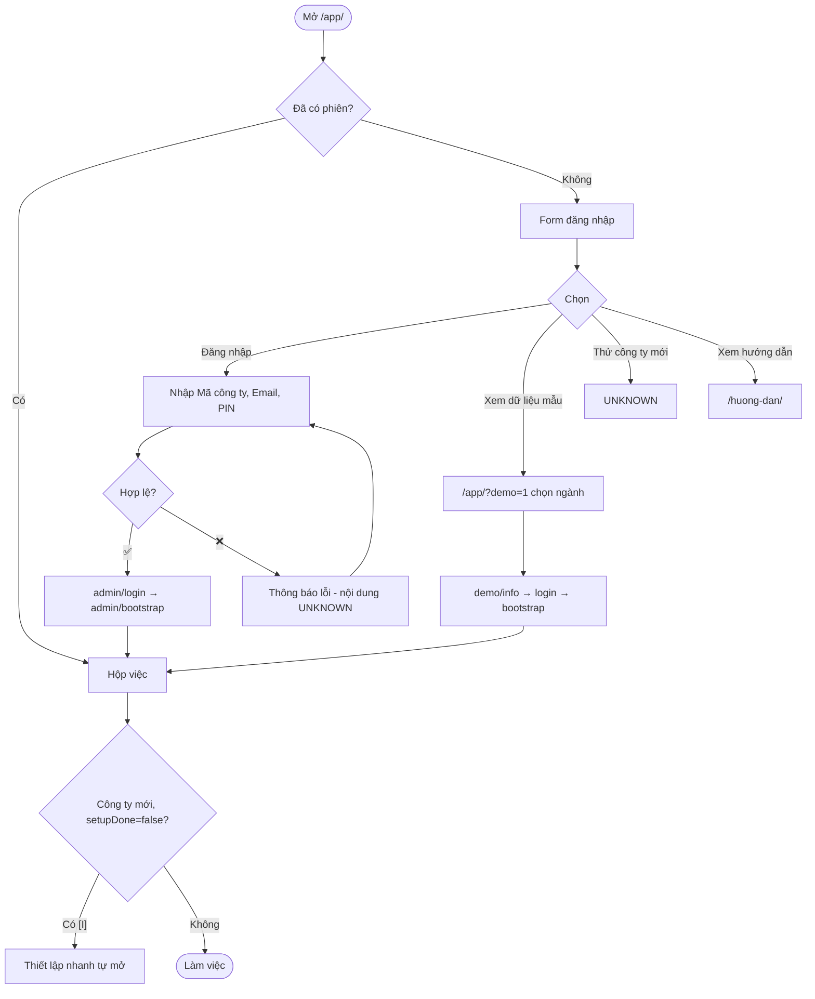

## UF-02 · Thiết lập công ty lần đầu (Thiết lập nhanh)

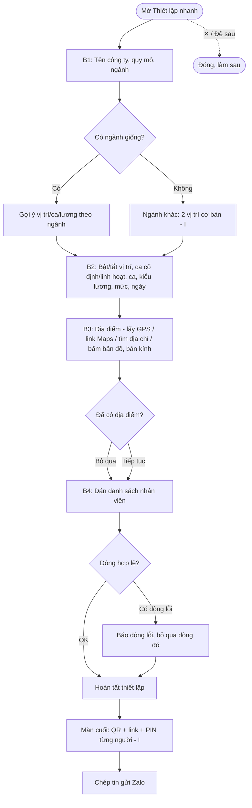

## UF-03 · Nhân viên chấm công vào/ra ca

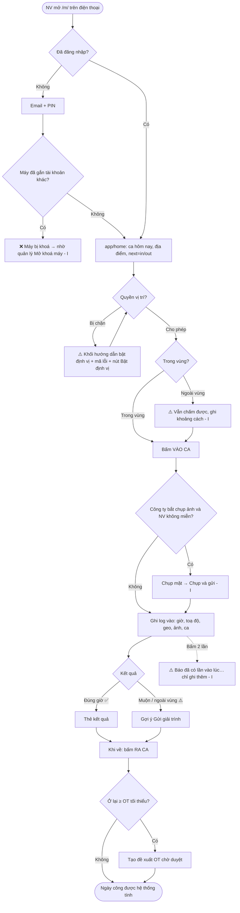

**Quy tắc ghép ca [C dữ liệu / I cơ chế]:** NV linh hoạt có thể chọn ca khi chấm (`log.shift`); hệ thống so giờ thực tế với khung ca — nếu chọn CHIEU mà giờ khớp SANG → cờ `sai_ca` + đề xuất "Xác nhận ca Ca sáng". Thiếu log ra → `thieu_ra`/"thiếu giờ". Không có log và không có đơn → `vang`.

## UF-04 · Quản lý duyệt việc hằng ngày (Hộp việc)

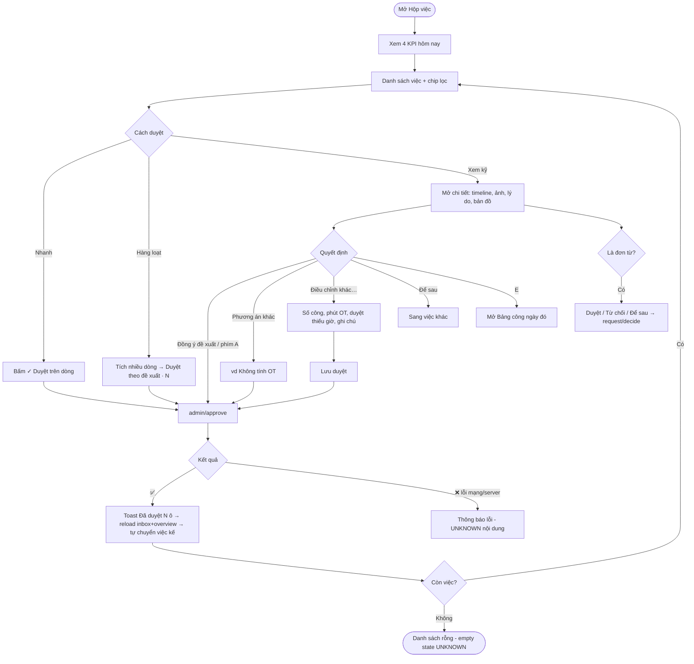

## UF-05 · Nhân viên gửi đơn / giải trình và quản lý xử lý

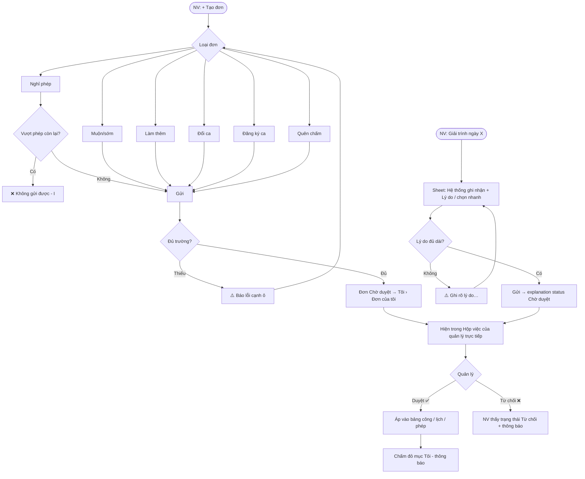

## UF-06 · Xếp ca tuần & nhận đăng ký

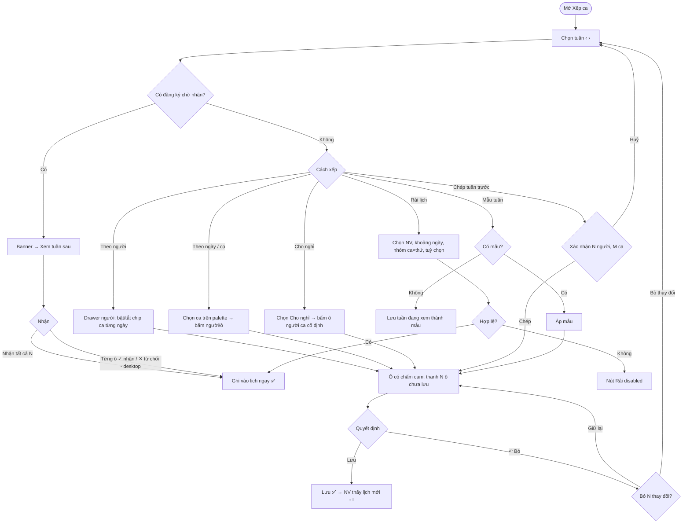

## UF-07 · Chốt & công bố lương

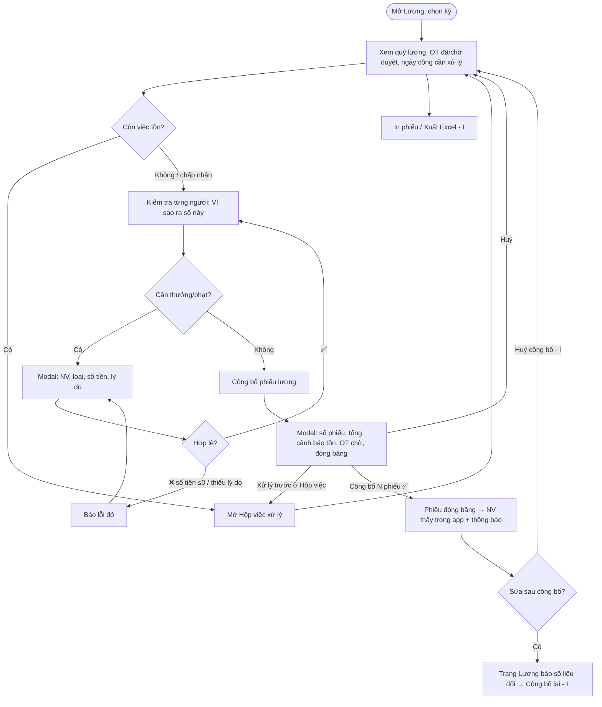

## UF-08 · Thêm nhân viên & mời cài app

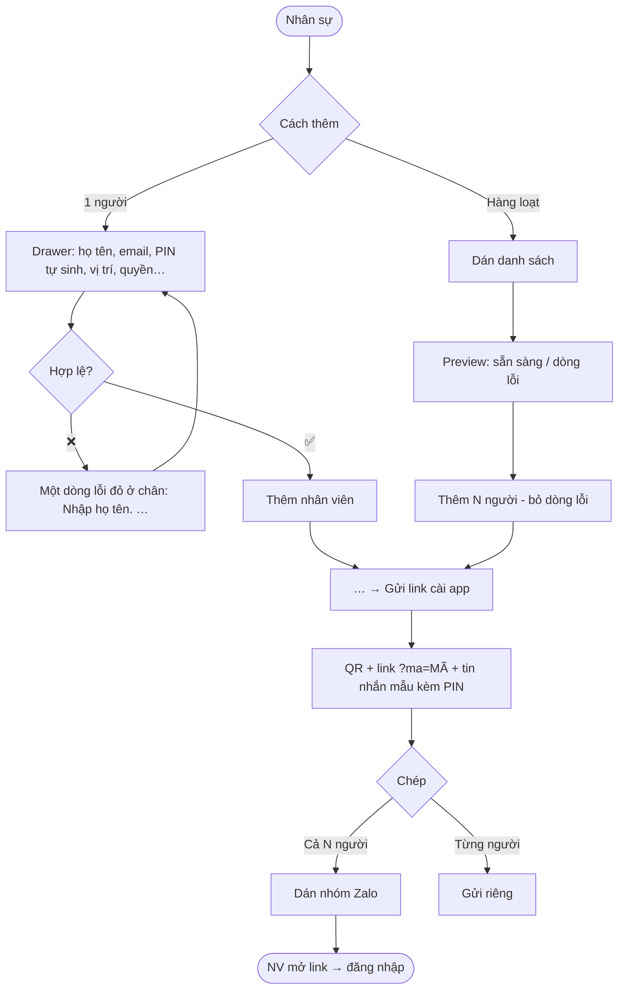

## UF-09 · Nhân viên nghỉ việc / đổi máy / quên PIN

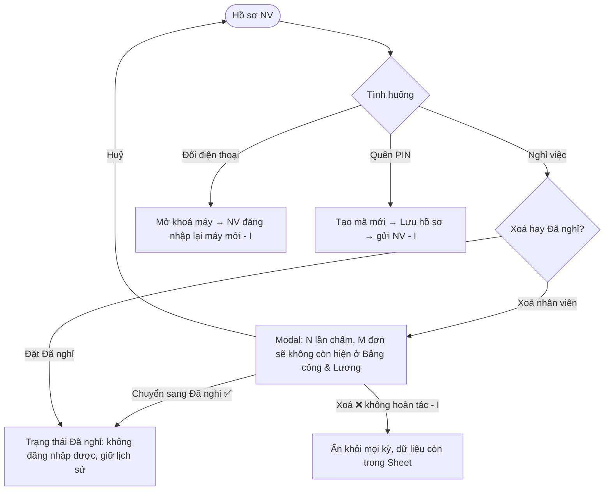

## UF-10 · Cấu hình địa điểm (geofence)

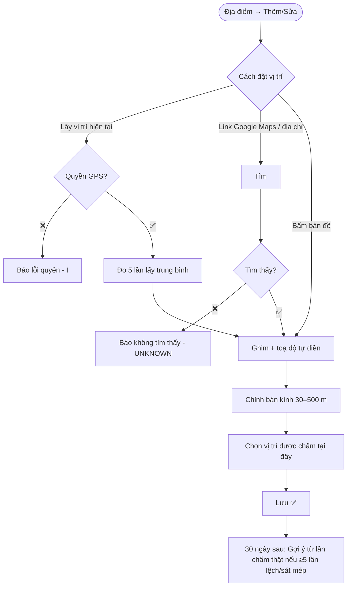

## UF-11 · Đổi cài đặt công ty

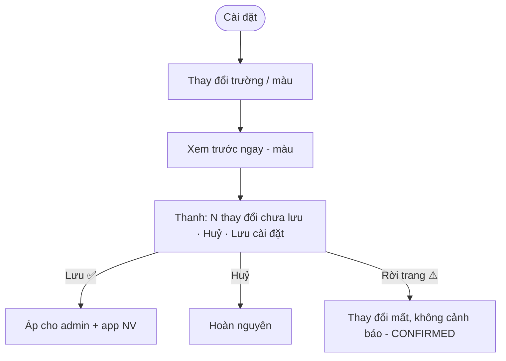
