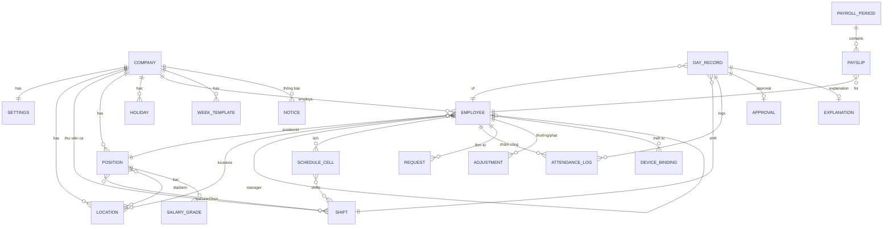

# 07. Phân tích dữ liệu (Data Model)

> Nguồn: response JSON mà giao diện tự tải (`admin/bootstrap`, `admin/inbox`, `admin/overview`, `admin/timesheet`, `admin/schedule`, `admin/payroll/status`, `admin/adjust/list`, `shop/plans`, `demo/info`, `app/home`) + giao diện + hướng dẫn.
> Trường có trong JSON = **[C]**. Trường suy ra từ form/UI nhưng chưa thấy trong JSON = **[I]**. Kiểu dữ liệu là kiểu dự kiến khi xây sản phẩm tương tự.
> Lưu ý: backend thật lưu trên Google Sheet (CONFIRMED tuyên bố); tên trường dưới đây là tên trong API, không phải tên cột Sheet (UNKNOWN).

## Sơ đồ quan hệ

## 1. Company (Công ty) — [C]
| Trường | Kiểu | Ví dụ | Ghi chú |
|---|---|---|---|
| code | string | `DEMO-FNB-Y5XBSX` | Mã công ty — dùng đăng nhập & link mời |
| name | string | Cà phê Phố Nhỏ | |
| address | string | 12 Hàng Bài… | |
| appName | string | Phố Nhỏ Chấm công | Hiện trên app NV |
| logo | string (URL) | "" | |
| brand | string (hex) | `#7b5236` | Màu chủ đạo |
| demo | boolean | true | |
| product | string | `HRM_PREMIUM` | Gói sản phẩm |
| seats | number | 0 | Số chỗ (theo gói) |
| tierLabel | string | "" | |
| activeStaff | number | 8 | |
| expires | string (date) | "" | Hạn gói |
| payroll | {entitled: bool, enabled: bool} | true/true | Quyền & bật tính lương |
| sheetUrl / photoFolder / botEmail | string | "" | Trong `settings` — Google Sheet, thư mục Drive, email bot |

## 2. Settings (Quy tắc công ty) — [C]
| Trường | Kiểu | Ví dụ | Ý nghĩa |
|---|---|---|---|
| workDays | int[] (0=CN … 6=T7) | [0..6] | Ngày làm việc chung |
| graceMode | enum `toan_bo` \| (phần vượt — tên giá trị [U]) | toan_bo | Cách tính phút muộn |
| otBefore | bool | false | Tính OT khi đến sớm |
| otMin | int (phút) | 30 | OT tối thiểu mặc định |
| otFromRequest | bool | true | Tự xác nhận OT theo đơn đã duyệt |
| weekTemplates | WeekTemplate[] | [] | Mẫu tuần |
| requireCamera | bool | false | Bắt buộc chụp ảnh |
| cameraForced | int | 0 | [U] |
| cutoffDay | int \| null | null | Ngày chốt kỳ lương (null = tròn tháng) |
| setupDone | bool | true | Đã xong thiết lập nhanh |
| industry | string | `fnb` | Ngành |
| steps[] | {key, label, done} | company, location, shift, position, staff, invite | Checklist onboarding (ở cấp bootstrap) |
| categories | {roles[], contracts[], statuses[]} | contracts: Full-time, Part-time, Thực tập, Cộng tác viên | Danh mục |

## 3. Location (Địa điểm) — [C]
| Trường | Kiểu | Ví dụ |
|---|---|---|
| id | string | `HK` |
| name | string | Quán Hoàn Kiếm |
| address | string | 12 Hàng Bài, Hoàn Kiếm, Hà Nội |
| lat, lng | float | 21.02452, 105.85308 |
| radius | int (m, 30–500 theo UI) | 60 |
| positions (vị trí được chấm) | string[] | [I] — thể hiện qua `position.diaDiem` |

## 4. Shift (Ca — thư viện dùng chung) — [C]
| Trường | Kiểu | Ví dụ | Ý nghĩa |
|---|---|---|---|
| code | string (bất biến) | `CA1`, `SANG`, `TV2` | Mã — không đổi được |
| name | string | Ca 1 (6h–14h) | |
| start, end | "HH:mm" | 06:00, 14:00 | |
| breakStart, breakEnd | "HH:mm" \| "" | 10:00–10:30 | Nghỉ giữa ca |
| std | number (giờ) | 7.5 | Giờ chuẩn 1 công |
| min1 | int (phút) | 420 | Đủ 1 công khi làm từ |
| min05 | int (phút) | 210 | Nửa công khi làm từ |
| grace | int (phút) | 5 | Cho phép muộn |
| minOT | int (phút) | 30 | OT tối thiểu |
| calc | enum `BLOCK` \| (giờ thực tế) \| (giờ thực tế + bắt lỗi) | BLOCK | Cách tính công — giá trị 2 loại sau [U] |
| part | bool | true (SANG/CHIEU/TOI) | **Ca ghép** (2–3 ca/ngày) — [I] khớp công tắc "Ca ghép" |
| hybrid | bool | false | [U] |
| overnight | bool | false | Qua đêm |
| khongBatLoi | bool | true (TV2) | Không bắt lỗi muộn/sớm |
| roles | string[] | ["Quản lý ca","Thu ngân"] | Vị trí dùng ca (hiển thị "Vị trí: …") |
| note | string | | |

Mã đặc biệt trong lịch: `OFF` = Cho nghỉ; `FLEXIBLE` = kiểu ca linh hoạt (ở Position/Employee). [C]

## 5. Position (Vị trí — mẫu cấu hình nhóm) — [C]
| Trường | Kiểu | Ví dụ |
|---|---|---|
| id | string | `vt_pha_che` |
| ten | string | Pha chế |
| ca | `FLEXIBLE` \| mã ca cố định | FLEXIBLE / `TV2` |
| caDuocChon | string[] (mã ca) | [SANG, CHIEU, TOI] |
| ngayLamViec | int[] | [0..6] |
| diaDiem | string[] (id địa điểm) | [HK, TX] — rỗng/"ở đâu cũng được" [I] |
| luong | SalaryConfig | xem dưới |
| bac | SalaryGrade[] | [{ten:"Bậc 1", muc:10000000}, …] |
| mienAnh / ghiChu | bool / string | [I] từ form |

### SalaryConfig (`luong`, cũng dùng cho `employee.salary`) — [C] + [I]
| Trường | Kiểu | Ví dụ | Ghi chú |
|---|---|---|---|
| loai | enum `Tháng` \| `Giờ` \| `Ngày` (= "Theo công/buổi") | Tháng | [C] |
| muc_luong | number (đ) | 10000000 / 60000 | Tháng hoặc đơn giá công |
| luong_gio_mac_dinh | number | 28000 | Đơn giá giờ |
| cong_chuan | number | 26 | |
| tong_phep | number | 12 | Ngày phép năm |
| he_so_ot / he_so_ot_cn / he_so_le | int (%) | 150 / 200 / 300 | Hệ số "Thứ Bảy nghỉ" — tên trường [U] |
| phat_bat | bool | false | Trừ phạt & BHXH |
| phat_muon (đ/phút), phat_quen (đ/lần), luong_bhxh, ty_le_bhxh (10.5) | number | | [I] từ form — tên trường [U] |
| phu_cap[] {kieu: theo_cong/co_dinh/thang_chia_cong, so_tien, ten} | | | [I] |
| thuong_co_dinh[] {ten, so_tien} | | | [I] |
| (employee) ngay_onboard, vi_tri, bac_luong, rieng{}, mau_luong, mau_ten | | | [C] — `rieng` = phần ghi đè riêng |

## 6. Employee (Nhân viên) — [C]
| Trường | Kiểu | Ví dụ | Ghi chú |
|---|---|---|---|
| email | string (khoá) | anh@phonho.vn | Định danh đăng nhập |
| name | string | Lê Ngọc Ánh | |
| status | enum `Đang làm` \| `Đã nghỉ` | Đang làm | |
| role | string | Phục vụ | Tên vị trí hiển thị |
| contract | enum | Part-time | |
| pin | string (4–8 số) | "1234" | **Trả về dạng rõ cho admin** (xem 09) |
| salary | SalaryConfig + meta | | |
| bac | string | Bậc 2 | |
| onboard | date | 2026-02-28 | Trước ngày này không tính vắng |
| noCamera / camera | bool / enum `theo_cong_ty`? \| `bat_buoc`? \| `mien` | true / "mien" | Giá trị khác ngoài "mien" [U] |
| portal | enum `""` (chỉ app) \| `manager` \| (nhân sự [U]) \| `admin` | admin / manager | Quyền trang quản trị |
| manager | email \| "" | ha@phonho.vn | Quản lý trực tiếp |
| shift | `FLEXIBLE` \| mã ca | FLEXIBLE | |
| locations | string[] | [HK] | |
| positionId | string | vt_phuc_vu | |

## 7. ScheduleCell (Ô lịch) — [C]
| Trường | Kiểu | Ví dụ |
|---|---|---|
| date | date | 2026-10-27 |
| email | string | anh@phonho.vn |
| shifts | string[] mã ca (hoặc `["OFF"]`) | ["CHIEU","TOI"] |

## 8. ShiftRegistration (Đăng ký ca) — [C]
| Trường | Kiểu | Ví dụ |
|---|---|---|
| row | int (dòng Sheet) | 2 |
| date | date | 2026-11-02 |
| email, name | string | |
| shift | mã ca | SANG |
| status | Chờ / Đã nhận / Từ chối | [I] |

## 9. AttendanceLog (Lần chấm) — [C]
| Trường | Kiểu | Ví dụ | Ghi chú |
|---|---|---|---|
| t | int | 29880839 | Mốc thời gian theo **phút** (Unix phút — INFERRED: 29.880.839 phút ≈ năm 2026) |
| at | "HH:mm" | 13:59 | |
| day | date | 2026-10-24 | |
| type | `in` \| `out` | in | |
| geo | `Hợp lệ` \| `Ngoài vùng` | | |
| location | string | Quán Tây Hồ / "Ngoài vùng" | |
| coords | "lat, lng" | 21.063898, 105.828298 | |
| photo | URL | /mau/anh-2.svg | Ảnh demo là SVG minh hoạ |
| synthetic | bool | false | Log do duyệt tạo ra (vd quên chấm) [I] |
| note | string | Đi công việc bên ngoài | Ghi chú khi chấm |
| shift | mã ca \| "" | CHIEU | Ca NV chọn khi chấm |

## 10. DayRecord (Ngày công — kết quả tính, theo NV × ngày × ca) — [C]
| Trường | Kiểu | Ý nghĩa |
|---|---|---|
| date | date | |
| shift | {code, name, start, end, overnight, free} | Ca ghép được |
| status | enum: `du` (đủ), `dang_lam`, `chua_toi`, `ot_cho`, `sai_ca`, `thieu_gio`, `ngoai_vung`, `vang`, … (`muon`, `nghi_phep`, `le`, `nua_cong` — [I]) | Trạng thái ô |
| in, out | "HH:mm" \| null | |
| inAbs, outAbs, startAbs, endAbs | int (phút) | Mốc tuyệt đối |
| breakAbs | [int,int] \| null | Nghỉ giữa ca |
| cong | number (0 / 0.5 / 1) | Công tính |
| expectedCong | number | Công kỳ vọng (ca ghép 0.5 — [C] 0.5 cho SANG) |
| late, early | int (phút) | |
| latePenalty, earlyPenalty | number (đ) | |
| waived | {late: bool, early: bool} | Tha muộn/sớm |
| worked | int (phút) | Làm trong ca |
| missing | int | Số lần thiếu chấm |
| ot | {before, after, extra, proposed, approved, state: `none`\|`cho_duyet`\|(đã duyệt)} | |
| flags | string[] — `ot_cho`, `sai_ca`, `thieu_ra`, `gps`, … | |
| notes | string[] | "Ở lại 98 phút sau ca, chờ duyệt OT" |
| holiday | {date,name} \| null | |
| offDay | bool | Ngày nghỉ (đi làm → OT) |
| explanation | {reason, status: `Chờ duyệt`…, sentAt} \| null | Giải trình |
| needsReview | bool \| null | Cần duyệt |
| approved | bool | |
| approval | object \| null | Nội dung duyệt [U cấu trúc] |
| planned | bool | Có trong lịch |
| logs | AttendanceLog[] | |

## 11. InboxItem (Việc cần xử lý — view model) — [C]
`id` (`email|date|shift`), `email`, `name`, `role`, `date`, `shift`, `day` (DayRecord), `flags`, `kind` (`ot`, `thieu_gio`, `vang`, `gps`, `sai_ca`, đơn…), `title`, `evidence[]`, `suggestion` {`label`, `ot`?, `codes[]`? — `duyet-log`, `duyet-gps`, `duyet-ca`}.

## 12. Approval (Lần duyệt) — [I]
| Trường | Kiểu | Ghi chú |
|---|---|---|
| email, date, shift | | Ô được duyệt |
| cong | `auto` \| 1 \| 0.5 \| 0 | "Theo hệ thống/Tự tính" |
| otMinutes | int \| null | |
| approveMissing | bool | "Duyệt thiếu giờ" |
| codes | string[] | duyet-log/duyet-gps/duyet-ca |
| waive | {late, early} | Tha muộn/sớm |
| note | string | |
| by, at | | Người duyệt, thời điểm |
API phản hồi: `{"success":true,"message":"Đã duyệt 1 ô."}` [C].

## 13. Request (Đơn từ) — [C] một phần
| Trường | Kiểu | Ghi chú |
|---|---|---|
| type | `Nghỉ phép` (Phép năm/Nghỉ ốm/Không lương) · `Muộn/sớm` · `Làm thêm` · `Đổi ca` · `Đăng ký ca` · `Quên chấm` | [C UI] |
| email | string | |
| from, to | date | "04/11 → 04/11" [C] |
| reason | string có tiền tố `[Nghỉ phép năm]`/`[Ca: SANG]` | [C] |
| status | `Chờ duyệt` / Đã duyệt / Từ chối | [C "Chờ duyệt"] |
| sentAt | datetime | "18:20:20 30/10/2026" [C] |
| Trường riêng theo loại: minutes, kind(trễ/sớm), shift, fromTime, toTime, task, swapDate, swapShift, inTime, outTime | | [I từ form] |

## 14. Adjustment (Thưởng/phạt nhập tay) — [C]
| Trường | Kiểu | Ví dụ |
|---|---|---|
| row | int | 2 |
| email | string | quynh@phonho.vn |
| type | `Thưởng` \| `Phạt` | Thưởng |
| amount | number | 500000 |
| note | string | Món mới bán chạy nhất tháng |
| period key | "YYYY-MM" | 2026-10 (từ response `key`) |

## 15. PayrollPeriod / Publication — [C]
| Trường | Kiểu | Ví dụ |
|---|---|---|
| key | "YYYY-MM" | 2026-10 |
| label | string | tháng 10/2026 |
| from, to, days, isMonthly | | 2026-10-01 … (từ `period`) |
| published | bool | false |
| at, by | datetime, email | "" |
| publishedNet | number | 0 |
| count | int | 0 |

## 16. Payslip (Phiếu lương / sao kê) — [C]
| Trường | Kiểu | Ví dụ |
|---|---|---|
| type | kiểu lương | Tháng |
| lines[] | {key, name, amt, how} | {key:"base", name:"Lương theo công", amt:11000000, how:"11.000.000 ÷ 26 công chuẩn × 26 công"} |
| net | number | 11000000 |
| pendingOT | number (đ) | 0 |
| summary | {cong, late, early, missing, otApproved, otPending, review, leave, holiday, shifts, worked} | worked tính bằng phút (11700 = 195h) |
Phiếu đã công bố là **bản chụp đóng băng** (snapshot) — [C văn bản].

## 17. Holiday — [C]
`{date: "2026-09-02", name: "Quốc khánh"}`

## 18. WeekTemplate — [I]
`{name: "Mẫu tuần 26/10", cells: [{dow, email, shifts[]}]}` — chỉ lưu ca xếp tay, không lưu ca cố định.

## 19. Notice (Thông báo NV) — [C]
`{id: "luong-2026-09", kind: "payslip", text, key, at, atIso}`

## 20. Leave balance — [C]
`{total: 12, used: 0, pending: 0, left: 12}`

## 21. DeviceBinding — [I]
`{email, deviceUid, boundAt}`; client giữ `ehr_device_uid` trong localStorage [C key].

## 22. Plan (Gói bán) — [C]
`{id, legacy, key: "premium", title: "Chấm công + Tính lương", name, terms: ["year","lifetime"], label: "Quy mô nhân sự", options:[{key:"t30", label, note, max_users:20, year:249000, lifetime:747000}, …]}`

## 23. Dữ liệu tổng hợp (view models) — [C]
- **Overview:** `now`, `today`, `stats {onShiftNow, inNow, lateToday, absentNow}`, `today_rows[{email,name,role,day,coords}]`, `trend[{date, planned, came, late, missing}]` (7 ngày), `feed[{t, at, day, type, email, name, location, geo, coords, photo, late}]`.
- **Demo info:** `{company, brand, industry, label, admin, accounts[{email, label}]}`.

## Bảng trạng thái ngày công (tổng hợp)
| Mã | Hiển thị | Màu | Cần duyệt | Kiểm chứng |
|---|---|---|---|---|
| du | Đủ công | brand đặc | Không | C |
| nua_cong | ½ | xanh nhạt | Không | I (mã) |
| muon | M | vàng | Có thể | C (ô), I (mã) |
| thieu_gio / thieu_ra / thieu_vao | ! | đỏ | Có | C |
| vang | V | đỏ | Có | C |
| ngoai_vung (flag gps) | G | viền đỏ | Có | C |
| sai_ca | C | viền vàng đứt | Có | C |
| ot_cho | + viền tím | | Có | C |
| ot đã duyệt | + tím đặc | | Không | C |
| nghi_phep | P | xanh dương | Không | C (ô), I (mã) |
| le | L | xám | Không | C (ô), I (mã) |
| dang_lam | • | — | — | C |
| chua_toi | Chưa tới | — | — | C |
| lam ngoài lịch | (Hộp việc) | | Có | I (hướng dẫn) |
