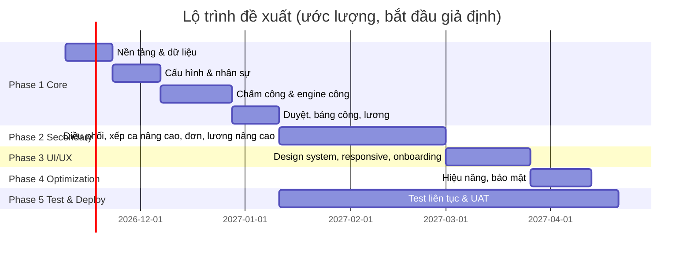

# 10. Lộ trình phát triển (Development Roadmap)

> Lộ trình để xây một Web App có chức năng & trải nghiệm tương tự E-HRM Pro. Giữ nguyên mô hình nghiệp vụ đã quan sát; các quyết định công nghệ là **đề xuất**, không phải sao chép.
> Tham chiếu ID chức năng ở `03-feature-inventory.md`.

## 1. Phân loại MoSCoW

### Must Have (MVP — không có thì không vận hành được)
| Nhóm | Chức năng |
|---|---|
| Nền tảng | Đa công ty (tenant theo Mã công ty), đăng nhập admin & NV (Mã công ty + Email + PIN), phân quyền 4 cấp (AUTH-01/04, STF-08) |
| Cấu hình | Thư viện ca (SHF-01/02), Vị trí với ca/ngày/địa điểm/lương (POS-01/03), Địa điểm geofence (LOC-02/03), Ngày lễ (HOL-01), Quy tắc công ty: ngày làm, cách tính muộn, OT, kỳ lương (SET-05…09) |
| Nhân sự | CRUD nhân viên, PIN, trạng thái Đã nghỉ, ghi đè lương/ca/địa điểm (STF-01…08) |
| Xếp ca | Xếp theo người, lưu thay đổi, ca cố định mặc định, Cho nghỉ (SCH-01…07, 13) |
| Chấm công (app NV) | Đăng nhập, ca hôm nay, GPS trong/ngoài vùng, VÀO/RA CA, chọn ca cho NV linh hoạt (EMP-01…04) |
| Engine ngày công | Ghép log vào ca (kể cả ca đêm, ca ghép), tính công (khung ca/giờ thực tế), muộn/sớm, thiếu chấm, vắng, ngoài vùng, sai ca, OT đề xuất |
| Duyệt | Hộp việc: danh sách + lọc + chi tiết + duyệt theo đề xuất + điều chỉnh (INB-04…19) |
| Bảng công | Lưới cả kỳ + drawer ngày + bảng công một người (TS-01, 04, 11, 13) |
| Đơn từ | Nghỉ phép, Quên chấm, Làm thêm; giải trình (EMP-10, 13) |
| Lương | Tính theo tháng/giờ/công, OT theo hệ số, sao kê "Vì sao ra số này", công bố & đóng băng, phiếu lương trong app NV (PAY-01/04/06, EMP-15/16) |

### Should Have
- Điều phối real-time: KPI, bản đồ, dòng thời gian ca, nhật ký 24h (LIVE-*).
- Duyệt hàng loạt (INB-08, TS-08); phím tắt J/K/A/E.
- Bảng công Theo tuần, Kỳ lệch / Tự chọn (TS-02/03/05).
- Rải lịch, Chép tuần trước, Mẫu tuần, đăng ký ca tuần sau & nhận đăng ký (SCH-08…12, EMP-12).
- Đơn Muộn/sớm, Đổi ca, Đăng ký ca (EMP-13).
- Phụ cấp, thưởng cố định, phạt, BHXH, bậc lương (POS-03); thưởng/phạt nhập tay (PAY-05).
- Xuất Excel bảng công / bảng lương, In phiếu PDF (TS-09, PAY-08/09).
- Thêm hàng loạt, Gửi link cài app + QR (STF-10/11).
- Chụp ảnh khi chấm + lưu ảnh (EMP-05, SET-08).
- Gắn thiết bị & Mở khoá máy (AUTH-05/06).
- Tìm nhanh Ctrl+K (GEN-01).
- Thông báo trong app NV (EMP-17).

### Nice to Have
- Dữ liệu mẫu theo 7 ngành + công ty demo tạm (DEMO-*).
- Thiết lập nhanh 4 bước, tour coach-mark, mẫu vị trí theo ngành (GEN-02/03, POS-02).
- Gợi ý chỉnh địa điểm từ lần chấm thật (LOC-04).
- Bảng "Số người mỗi ca" (độ phủ ca, cảnh báo ô đỏ) ở Xếp ca desktop (SCH-16).
- Màu thương hiệu & logo tuỳ biến (SET-04).
- Sparkline KPI; "Sắp vào ca".
- Lưu dữ liệu song song Google Sheet / kiểm tra dữ liệu Sheet (SET-02/10/11) — chỉ nếu chọn cùng mô hình lưu trữ.
- Bán gói, upsell, thanh toán QR (SHOP-*).
- PWA cài lên màn hình chính, hướng dẫn iPhone/Android (EMP-18/20).

## 2. Các giai đoạn

### Phase 1 — Core functionality (≈ 8–10 tuần, ước lượng)
**Mục tiêu:** một công ty thật chấm công và trả lương được 1 kỳ.
1. **Kiến trúc & nền tảng**: chọn stack (gợi ý: React + Ant Design cho admin để bám UX quan sát; PWA cho NV; backend REST/RPC; CSDL quan hệ — quyết định có đồng bộ Google Sheet hay không là quyết định sản phẩm, cần chốt sớm). Multi-tenant, auth, RBAC.
2. **Mô hình dữ liệu** theo `07-data-model.md`: Company, Settings, Location, Shift, Position (+SalaryConfig), Employee, ScheduleCell, AttendanceLog, DayRecord, Approval, Request, Payslip, Holiday.
3. **Cấu hình**: CRUD ca, vị trí, địa điểm (bản đồ Leaflet + ghim + bán kính), ngày lễ, quy tắc công ty.
4. **Nhân sự**: CRUD + PIN + quyền + ghi đè.
5. **Xếp ca** cơ bản (theo người, lưu).
6. **App NV – chấm công**: geolocation, geofence phía server, VÀO/RA, chọn ca.
7. **Engine ngày công** (phần khó nhất): ghép ca, ca đêm, ca ghép, BLOCK vs giờ thực tế, grace mode, min1/min05, OT đề xuất ≥ minOT, cờ bất thường, ngày nghỉ/lễ. Viết unit test bảng quyết định từ chính các ví dụ trong UI (vd "cho phép 5', muộn 14' → 14' / 9'").
8. **Hộp việc** + duyệt theo đề xuất + điều chỉnh; **Bảng công** lưới + drawer.
9. **Đơn**: Nghỉ phép (trừ phép), Quên chấm, Làm thêm; giải trình.
10. **Lương** theo 3 kiểu + OT + công bố/đóng băng + phiếu trong app NV.

**Tiêu chí hoàn thành:** chạy end-to-end với dữ liệu tương đương demo "Cà phê Phố Nhỏ" và cho ra đúng các con số đã quan sát (vd 10.000.000 ÷ 26 × 26; OT 90p × 51.282 × 150% = 115.385; 79,35h × 25.000 = 1.983.750).

### Phase 2 — Secondary functionality (≈ 6–8 tuần)
- Điều phối real-time (polling 60s), bản đồ trạng thái, dòng thời gian ca.
- Duyệt hàng loạt (Hộp việc & Bảng công), phím tắt.
- Bảng công Theo tuần, Kỳ lệch, Tự chọn, bảng công từng người, deep link `?ngay&nv`.
- Xếp ca: chế độ cọ/kéo, Xếp theo ngày, Rải lịch, Chép tuần, Mẫu tuần, Cho nghỉ, đăng ký ca tuần sau ↔ nhận đăng ký.
- Đơn Muộn/sớm, Đổi ca; thông báo NV; Đơn của tôi.
- Lương nâng cao: bậc, phụ cấp (3 kiểu), thưởng cố định, phạt muộn/quên chấm, BHXH, hệ số OT theo loại ngày, thưởng/phạt nhập tay, công bố lại / huỷ công bố.
- Xuất Excel, In phiếu.
- Nhân sự: thêm hàng loạt (parser + preview), mời qua QR/link, gắn thiết bị + mở khoá, chụp ảnh + lưu trữ ảnh.
- Tìm nhanh Ctrl+K.

### Phase 3 — UI/UX refinement (≈ 3–4 tuần)
- Áp design tokens `05-ui-ux-specifications.md` (màu ngữ nghĩa, bo 18/14/10/999, bóng card, Be Vietnam Pro).
- Timeline bar dùng chung; tag trạng thái; skeleton; toast; sticky bar thay đổi chưa lưu; xác nhận có nội dung cụ thể.
- Responsive 2 bố cục (≥992 sidebar, <992 bottom nav + drawer "Thêm"); master–detail desktop.
- Màu thương hiệu tuỳ biến + xem trước; logo.
- Onboarding: Thiết lập nhanh 4 bước, mẫu ngành, coach-mark, nút "?".
- **Khắc phục các điểm yếu đã quan sát** (không lặp lại): cảnh báo khi rời trang có thay đổi chưa lưu; sticky bar không chồng bottom nav; hiển thị ô đăng ký ca trên lưới mobile; câu chữ "bấm Lưu" khớp nút; tuỳ chọn nhập lý do khi từ chối đơn; Esc đóng drawer.

### Phase 4 — Optimization (≈ 2–3 tuần)
- Hiệu năng: code-splitting theo trang, prefetch, cache bootstrap, phân trang/ảo hoá lưới bảng công cho 120 NV × 31 ngày.
- Tính toán ngày công/lương: cache theo kỳ, tính lại theo sự kiện (log mới, duyệt, sửa cấu hình); đảm bảo nhất quán giữa Hộp việc – Bảng công – Lương (tránh lệch như đã quan sát).
- Bảo mật: hash PIN, giới hạn số lần thử, token an toàn, geofence & thời gian chấm xác thực phía server, audit log duyệt.
- Gợi ý chỉnh địa điểm từ lần chấm thật.
- Kiểm tra dữ liệu / nhập file Excel/JSON.
- PWA: manifest, offline tối thiểu cho màn chấm công (tuỳ chọn).

### Phase 5 — Testing & deployment (≈ 2–3 tuần, chạy song song từ Phase 2)
- **Unit test** engine công & lương với bộ case: đúng giờ, muộn trong/ngoài grace (2 chế độ), về sớm, nửa công, thiếu vào/ra, vắng, ngoài vùng, sai ca, ca đêm qua 0h, ca ghép 2–3 ca/ngày, ngày nghỉ đi làm (OT), ngày lễ (ca cố định đủ công), nghỉ phép (1 công, trừ phép), Cho nghỉ (0 công, không vắng), onboard giữa kỳ, kỳ lệch, BHXH chỉ kỳ tròn tháng.
- **Integration/E2E**: các luồng `06-user-flows.md` (UF-01…11).
- **Thiết bị**: iPhone Safari & Android Chrome — quyền vị trí, camera (theo FAQ: Safari camera, Android camera đen).
- **UAT** với 1–2 quán thật; so sánh lương với bảng tính thủ công.
- **Triển khai**: môi trường staging/prod, backup, giám sát lỗi, form báo lỗi; trang hướng dẫn quản trị & nhân viên; dữ liệu demo theo ngành (Nice to have).

## 3. Phụ thuộc & rủi ro chính

| Rủi ro | Ảnh hưởng | Giảm thiểu |
|---|---|---|
| Engine ngày công phức tạp (ca đêm, ca ghép, nhiều chế độ tính) | Sai công → sai lương | Đặc tả bảng quyết định + test case trước khi code |
| Độ chính xác GPS trong nhà | Báo ngoài vùng oan | Bán kính mặc định 60–150 m, cho chấm ngoài vùng kèm duyệt, gợi ý từ lần chấm thật |
| Lựa chọn lưu trữ (DB vs Google Sheet) | Hiệu năng, tính nhất quán | Chốt sớm; nếu đồng bộ Sheet thì làm 1 chiều/có hàng đợi |
| Quyền camera/vị trí trên iOS/Android | NV không chấm được | Màn hướng dẫn lỗi có mã lỗi như bản tham khảo |
| Chống chấm hộ | Gian lận | Gắn thiết bị + ảnh + geofence server |
| Đóng băng phiếu lương | Tranh chấp số liệu | Snapshot bất biến + lịch sử công bố |

## 4. Mốc tổng thể (ước lượng)

